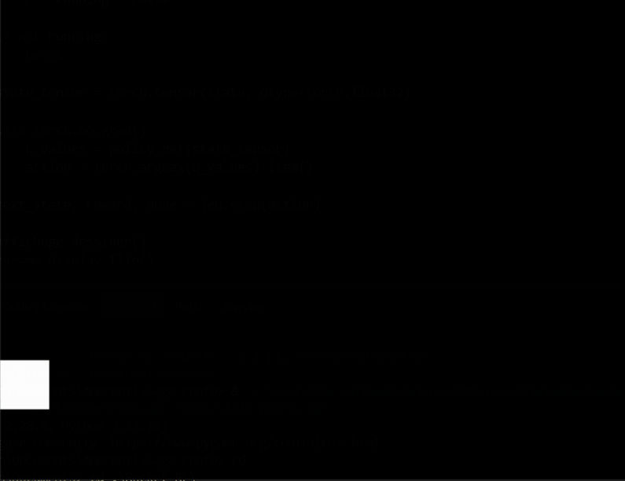

# Reinforcement Learning — Geometry Dash avec DQN

Ce projet consiste à créer un jeu en **Python** inspiré de *Geometry Dash* (une version très primitive de *Geometry Dash*), puis à entraîner un agent à y jouer grâce à un **Deep Q-Network (DQN)**.

## Fichiers

- **`Jeu.ipynb`** : version jouable avec affichage. Trois obstacles : piques, carrés et plateformes.
- **`Jeu_RL`** : version sans affichage pour accélérer l'entraînement.
- **`DQN`** : implémentation de l'agent, entraînement et visualisation de ses performances.
- **`utils_pourRL`** : fonctions et classes utilitaires.

## Fonctionnement

L'agent reçoit un **état de dimension 5** contenant :
- La position et la vitesse verticales du joueur.
- La distance aux deux prochains obstacles.
- Le type et la hauteur de cet obstacle.

Il choisit entre deux actions : **sauter ou ne rien faire**.

Le DQN estime la valeur de chaque action à partir de l'état courant :

$$
Q(s,a) \approx r + \gamma \max_{a'}Q(s',a')
$$

L'entraînement utilise :
- Une stratégie **ε-greedy** pour équilibrer exploration et exploitation.
- Une **replay memory** pour réutiliser les transitions passées.
- Un **target network** pour stabiliser l'apprentissage.

## Résultats

L'objectif est d'apprendre à franchir les obstacles et à progresser le plus loin possible. Voici un exemple après un entrainement de 5 minutes sur mon CPU.

A noter qu'il faut s'assurer que les états soient dans des ordres de grandeur similaires et donc renormaliser: j'ai passé beaucoup de temps à régler certains hyperparamètres alors que le problème était les ordres de grandeurs de mes états.

## Améliorations possibles

- Prendre en compte plus d'obstacles successifs.
- Tester des variantes comme **Double DQN**.
- Utiliser un **CNN** pour apprendre directement à partir des images du jeu. 
- Améliorer le fonctionnement du jeu, mettre d'autre niveau.